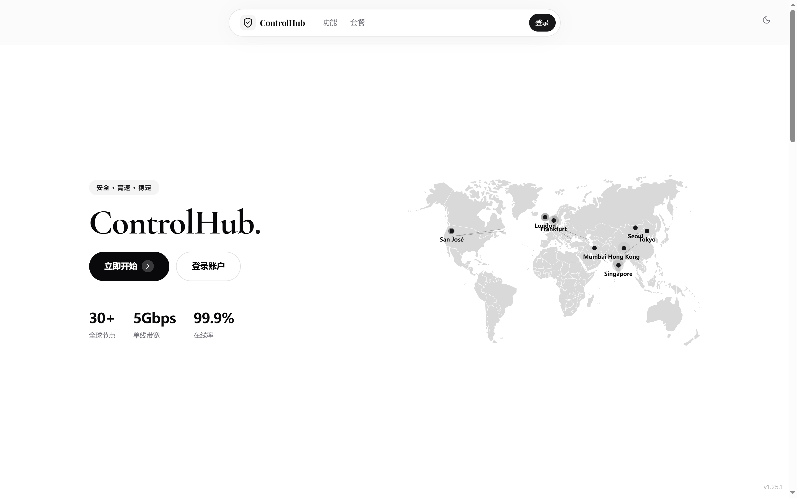
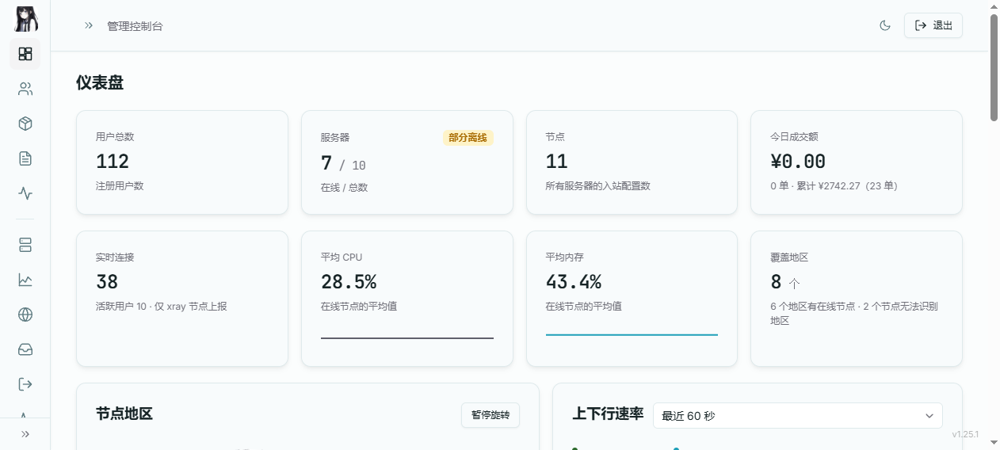
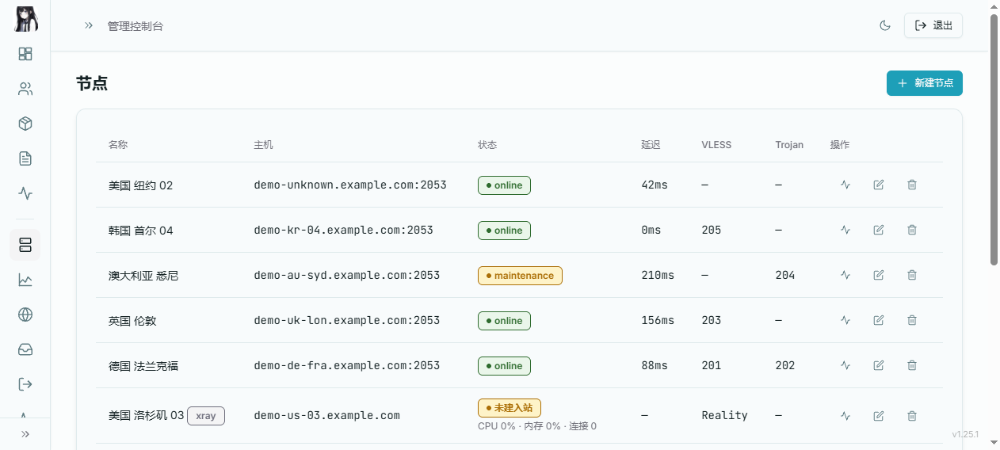

# ControlHub

企业级跨境电商网络服务运营平台 | Enterprise Cross-border Network Service Platform

**版本：2.0.0**

<!-- PROJECT SHIELDS -->
[![Version][version-shield]][version-url]
[![License][license-shield]][license-url]
[![PHP][php-shield]][php-url]
[![Vue][vue-shield]][vue-url]

---

[English](#english) | 中文

## 界面预览

用户端首页：



管理端 · 仪表盘（节点监控 / 3D 地球）：



管理端 · 节点管理：



## 一键安装

```bash
curl -fsSL https://raw.githubusercontent.com/YouzSpace/3xui-hub/main/install.sh | bash
```

安装完成后使用 `3hub` 命令管理系统。

## Docker 部署

```bash
git clone https://github.com/YouzSpace/3xui-hub.git
cd 3xui-hub/docker
docker-compose up -d
```

访问 `http://localhost:8080`

```bash
docker-compose logs -f        # 查看日志
docker-compose down           # 停止
docker-compose restart        # 重启
docker-compose up -d --build  # 更新并重启
```

## 功能特性

### 管理端

- **仪表盘**：用户与收入统计、节点状态与实时指标；流量排行支持"用户口径"与"机器口径"对照，可展开单个用户在各机器上的分布，支持 CSV 导出
- **用户管理**：增删改查、分配套餐、续费、重置流量、重置密码、切换协议
- **节点管理**：面板节点（兼容 3x-ui）与裸内核节点（agent 自动部署、自升级、实时指标）
- **节点配置**：入站 / 出站 / 路由规则 / WARP 出口，支持多协议、多传输方式与伪装配置；入站列表支持多选批量删除
- **套餐与订单**：周期 / 总量套餐、流量倍率、第三方订阅捆绑、多渠道支付与回调
- **优惠码与邀请**：文件夹分组（可改名，删文件夹只退回未归档）、搜索命中文件夹内的码只显示文件夹、勾选批量导出 CSV（文件名自填）与批量删除、生成时自定义码前缀、单次最多生成 500 个；邀请返利
- **邮件系统**：SMTP 配置、通知场景开关、批量群发、每月定时发信、发信日志
- **多域名**：绑定、SSL 申请与自动续期、Nginx 配置助手
- **站点与内容**：站点名称 / Logo / 公告 / 自定义首页、教程分类与 Markdown 编辑
- **系统工具**：异步任务日志（失败可重试）、数据库备份与差异合并、Google 二步验证、PHP 运行时安全基线检测与 ini 缓解（`php artisan php:secure`）

### 用户端

- 登录 / 注册 / 找回密码（邮箱 + Token 双登录方式）
- 仪表盘：流量统计、订阅地址与二维码、节点列表、使用文档入口
- 订阅导出：Clash / Sing-box / Base64 三种格式，支持节点旗帜与重命名
- 订购与支付：套餐选择、在线支付、流量重置包、历史订单查询
- 公告与文档：全屏公告页、分类教程二级页面
- 邀请返利、问题反馈入口

### 自动化

- 流量自动同步：每 5 分钟同步全部用户用量
- 超量 / 到期只关流量，永不封禁账号，用户仍可登录续费
- 到期与超量提醒：同一场景只提醒一次，续费或重置后恢复
- 队列分流：节点任务与邮件任务独立队列，不阻塞定时任务
- 节点 client 对账：每 5 分钟把「面板认为该开、节点上却被关掉」的 client 自动恢复（`users:reconcile-enable`）
- 节点 agent 自升级、php-fpm 并发自动调优

## 3hub 管理命令

```bash
3hub status        # 系统状态
3hub check-update  # 检测更新
3hub update        # 更新系统
3hub admin-user    # 修改管理员账号
3hub admin-pass    # 修改管理员密码
3hub sync          # 手动同步流量
3hub sync-status   # 自动同步状态
3hub backup        # 数据库备份（/var/backups/3xui-hub，保留 7 份，每天 03:30 自动执行）
3hub log           # 错误日志
3hub restart       # 重启服务
3hub ssl           # 配置域名与 SSL
3hub domain        # 多域名管理（add / renew / remove / status）
3hub fix-nginx     # 补全 nginx 节点资产配置（老版本升级后使用）
3hub uninstall     # 卸载（--panel / --app / --all）
```

## 技术栈

| 层级 | 技术 |
|------|------|
| 后端 | Laravel 13 + PHP 8.3+ + MySQL |
| 前端 | Vue 3.5 + Vite 8 + Pinia 3 + Tailwind CSS 3 |
| 动画 | GSAP 3 |
| 认证 | Session（管理员）+ Bearer Token（用户） |
| 支付 | MD5 签名对接第三方支付网关 |
| 2FA | Google Authenticator (TOTP) |

## 版本记录

完整更新历史见 [CHANGELOG.md](CHANGELOG.md)。

## 许可证

MIT License

---

# English

# ControlHub

Enterprise cross-border network service platform — centralized management of nodes, users, plans, orders and payments.

**Version: 2.0.0**

## Screenshots


## Quick Install

```bash
curl -fsSL https://raw.githubusercontent.com/YouzSpace/3xui-hub/main/install.sh | bash
```

After installation, use the `3hub` command to manage the system.

## Docker Deploy

```bash
git clone https://github.com/YouzSpace/3xui-hub.git
cd 3xui-hub/docker
docker-compose up -d
```

Visit http://localhost:8080

## Features

- User / node / plan / order management, traffic ranking by user and by machine
- Panel nodes and bare-kernel nodes with an auto-upgrading agent
- Inbound / outbound / routing / WARP configuration, multi-protocol and multi-transport
- Plans, orders, multi-channel payment gateway, discount codes, referrals
- Email notifications, batch and scheduled sending, delivery logs
- Multi-domain with SSL issuance and renewal
- Clash / Sing-box / Base64 subscription export
- Auto traffic sync; over-quota users lose traffic only — accounts are never banned
- Queue isolation so batch work never blocks scheduled jobs
- Google 2FA, database backup and migration, 3hub CLI

## Tech Stack

- Backend: Laravel 13 + PHP 8.3+ + MySQL
- Frontend: Vue 3.5 + Vite 8 + Pinia 3 + Tailwind CSS 3
- Animation: GSAP 3
- Payment: MD5 signed third-party gateway
- 2FA: Google Authenticator (TOTP)

## License

MIT License

<!-- LINKS -->
[version-shield]: https://img.shields.io/badge/version-2.0.0-blue
[version-url]: https://github.com/YouzSpace/3xui-hub/releases
[license-shield]: https://img.shields.io/badge/license-MIT-green
[license-url]: #许可证
[php-shield]: https://img.shields.io/badge/PHP-8.3+-777BB4
[php-url]: https://php.net
[vue-shield]: https://img.shields.io/badge/Vue-3-4FC08D
[vue-url]: https://vuejs.org
